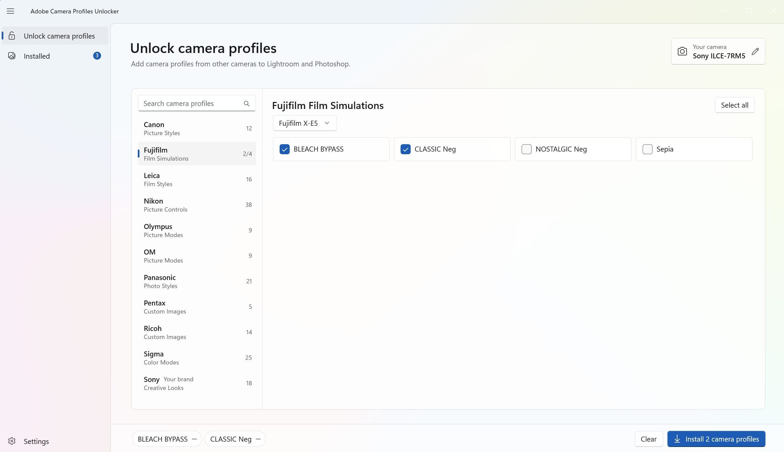
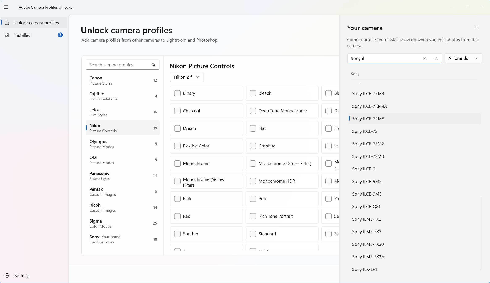
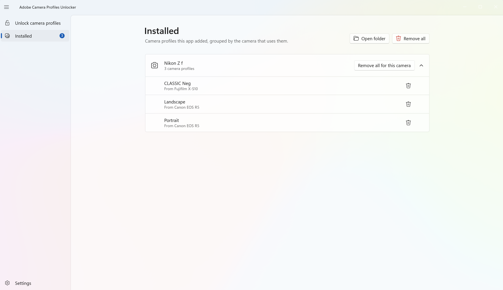

# © 2024 Phan Xuan Quang / Adobe Camera Profiles Unlocker

A Windows app that copies camera profiles (camera-matching color profiles such as Fujifilm *Classic Chrome* or Canon *Portrait*) from one camera model to another, so Adobe Camera Raw, Lightroom Classic and Photoshop show them for **your** camera.

Example: use Fujifilm Film Simulations on raw photos from a Sony ILCE-7M4.

## :sparkles: Features
- Pick your camera once. The app remembers it.
- Browse camera profiles by brand, or search across all brands.
- Choose which model to copy from ("Copied from"). The model with the most camera profiles is picked by default.
- Install many camera profiles at once, with Cancel and Undo.
- See and remove what you installed, per camera. Removing also has Undo.
- No admin rights needed. Adobe's original files are never changed.
- Follows the Windows light or dark theme.

## :pushpin: Supported camera brands
Canon, Fujifilm, Leica, Nikon, Olympus, OM Digital Solutions, Panasonic Lumix, Pentax, Ricoh, Sigma and Sony.

The full list of camera models is in [Supported Camera Models.md](Supported%20Camera%20Models.md). What you see in the app depends on the Camera Raw version installed on your PC.

## :computer: System requirements

| | Minimum | Recommended |
|---|---|---|
| Windows | Windows 10 version 1809 (x64 or ARM64) | Windows 11 |
| Adobe Camera Raw | 15.0 | [Latest version](https://www.adobe.com/go/acr_installer_win) |
| Adobe Photoshop or Lightroom Classic | 2022 | Latest version |

## :blue_book: How to use

### Windows
1. Download the latest version from the [Releases page](https://github.com/phanxuanquang/Adobe-Camera-Profiles-Unlocker/releases/latest).
2. Open the app and pick **your camera**.
3. Pick a brand, tick the camera profiles you want, then select **Install**.
4. Restart Photoshop or Lightroom.
5. In Camera Raw or Lightroom, open the **Profile** browser. The new camera profiles are listed as `<Source camera>: <Profile name>`.

| Pick your camera | Manage installed camera profiles |
|---|---|
|  |  |

To remove camera profiles, open the **Installed** page.

### macOS (manual)
The app runs on Windows only. To use the camera profiles on a Mac:
1. Install them on a Windows PC for the Mac user's camera.
2. Copy `C:\ProgramData\Adobe\CameraRaw\CameraProfiles\Phan Xuan Quang` to `/Library/Application Support/Adobe/CameraRaw/CameraProfiles/` on the Mac.
3. Copy `C:\ProgramData\Adobe\CameraRaw\Settings\Phan Xuan Quang` to `/Library/Application Support/Adobe/CameraRaw/Settings/` on the Mac.
4. Restart Photoshop or Lightroom.

## :exclamation: Important notes
- Camera profiles apply to **raw** files only (for example `.ARW` for Sony, `.NEF` for Nikon).
- You **must** restart Adobe apps after you install or remove camera profiles.
- Installed files go to the `Phan Xuan Quang` subfolders of `C:\ProgramData\Adobe\CameraRaw\CameraProfiles` and `C:\ProgramData\Adobe\CameraRaw\Settings`.
- Camera profiles installed by older versions of this app are detected on the **Installed** page. Removing them asks for admin permission once.

## :handshake: Contributing
Bug reports, ideas and pull requests are welcome. Read [CONTRIBUTING.md](CONTRIBUTING.md) first.

## :gift: Support me

