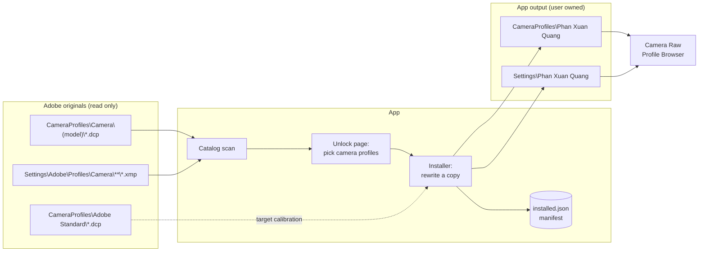

# Maintainer docs

Adobe Camera Profiles Unlocker is a Windows app. It copies camera profiles (camera-matching color profiles such as Fujifilm *CLASSIC CHROME* or Canon *Portrait*) from one camera model to another, so Camera Raw, Lightroom Classic and Photoshop show them for the user's own camera.

Users: photographers, mostly non-technical, on Windows 10 1809+ or Windows 11 with Camera Raw installed.

## Read next

| Doc | Read it when you... |
|---|---|
| [architecture.md](architecture.md) | add code: projects, layers, contracts, DI lifetimes, threading, logging |
| [camera-profiles.md](camera-profiles.md) | touch the catalog, installers or storage: Adobe folders, DCP and XMP formats, rewrite rules |
| [ui.md](ui.md) | change a screen: navigation, page behavior, wording, accessibility |
| [development.md](development.md) | build, test, review, release, or need the coding conventions |
| [decisions.md](decisions.md) | wonder "why is it like this?" before changing it |

## How it works

1. At startup the app scans Adobe's camera profile folders once and builds a list of brands, models and camera profiles.
2. The user picks **their camera** (the target), a brand, a source model and some camera profiles.
3. For each camera profile the installer reads the Adobe file, rewrites a few tags in memory (name, copyright, camera restriction) and writes a **new** file into the app's own subfolder. Adobe files are never changed.
4. Each written file is recorded in a manifest. Only files in the manifest can ever be deleted, with Undo.
5. After a restart, Camera Raw finds the copies and lists them as `<Source camera>: <Profile name>`.

## Glossary

| Term | Meaning |
|---|---|
| **Camera profile** | One camera-matching color profile, e.g. Fujifilm `CLASSIC CHROME`. The only word used in UI and code (never "look", never bare "profile"). |
| **Brand** | Camera maker. Each has a family name: Fujifilm *Film Simulations*, Canon *Picture Styles*, Nikon *Picture Controls*, Sony *Creative Looks*, Panasonic *Photo Styles*, Leica *Film Styles*; others *Camera Profiles*. |
| **Source model** | The camera whose camera profiles are copied ("Copied from"). Default: the brand's model with the most camera profiles. |
| **Target / Your camera** | The user's camera. Set once, saved in settings. |
| **DCP** | DNG Camera Profile. Binary, TIFF-based. |
| **XMP profile** | Text (XML) camera profile in the `crs:` namespace. Newer Fujifilm, Nikon, Panasonic, Ricoh and Sigma profiles. |
| **Installed camera profile** | A file the app wrote, tracked in the manifest. |

## Out of scope

macOS app (users copy files by hand, see the root README), editing camera profile content, lens profiles, presets, localization (English only; strings stay in VMs and XAML so it can be added later).
