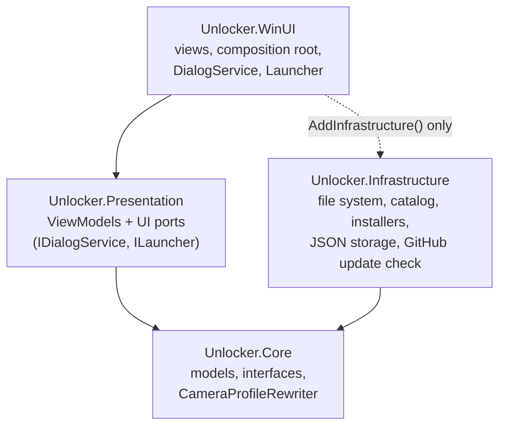
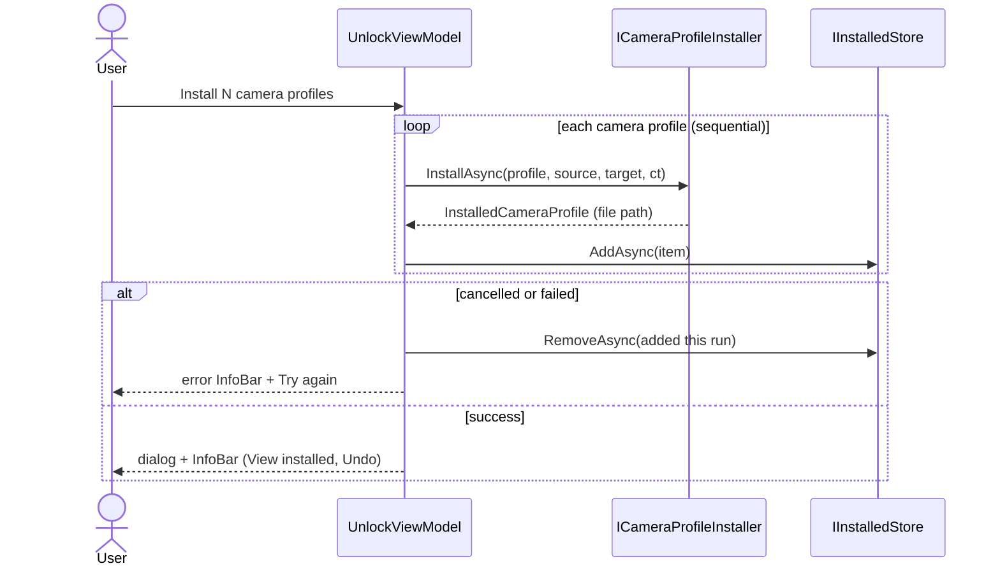

# Architecture

.NET 10, WinUI 3 (Windows App SDK 2.7), CommunityToolkit.Mvvm. The UI framework is replaceable: all app logic lives in ViewModels that know only interfaces.

## Layers



| Project | Target | References | Rule |
|---|---|---|---|
| `Unlocker.Core` | `net10.0` | nothing | Pure models, contracts and rules. No I/O. |
| `Unlocker.Infrastructure` | `net10.0-windows` | Core | Implements the Core interfaces. Classes are `internal sealed`, exposed only through `AddInfrastructure()`. |
| `Unlocker.Presentation` | `net10.0` | Core | ViewModels. **Never** references `Microsoft.UI.*`, `System.Windows.*` or Infrastructure. |
| `Unlocker.WinUI` | `net10.0-windows10.0.26100.0` | Presentation, Infrastructure | Views and platform services. Builds x64 and ARM64 only, never AnyCPU. |
| `tests/Unlocker.Tests` | | all | MSTest 4. |

A new UI (e.g. WPF) would be one new project with views, `IDialogService`, `ILauncher` and its own composition root. All ViewModels are reused.

No extra layers: use cases live in ViewModels. No mediator, repository, use-case classes or mappers. Add a layer only when a second caller exists.

## Source layout

```
Directory.Build.props        shared: Nullable, ImplicitUsings, TreatWarningsAsErrors, CPM, version, author
Directory.Packages.props     every package version (central package management)
global.json                  .NET SDK
src/
  Unlocker.slnx              x64 + ARM64, includes the test project
  Unlocker.Core/             Abstractions/  Models/  Enums/  Rules/
  Unlocker.Infrastructure/   Catalog/  Installing/  Storage/  Updates/  Platform/  Serialization/
  Unlocker.Presentation/     Common/  Ports/  Shell/  Startup/  Unlock/  Installed/  Settings/   (one folder per screen)
  Unlocker.WinUI/            App.xaml(.cs)  MainWindow  Pages/  Controls/  Services/
tests/
  Unlocker.Tests/            Core/  Infrastructure/  Presentation/  Fakes/  Support/  Fixtures/
  ui-tests.ps1               UI smoke batch against the running app
```

One type per file. File name = type name. Folder = namespace.

## Contracts

Core models are immutable records (`Unlocker.Core/Models`):

```csharp
record CameraProfile(string Name, string SourcePath, CameraProfileFormat Format);   // Format: DCP | XMP
record CameraModel(string Name, IReadOnlyList<CameraProfile> Profiles);
record Brand(string Name, string Family, IReadOnlyList<CameraModel> Models);
record InstalledCameraProfile(string Name, string SourceModel, string TargetModel, IReadOnlyList<string> Files);
record ReleaseInfo(Version Version, Uri PageUrl);                                     // release page, not a download
```

Backend ports (`Unlocker.Core/Abstractions`):

| Interface | Job |
|---|---|
| `ICameraCatalog.LoadAsync` | Brands, models and camera profiles, sorted. Scans once, then cached. A failed scan is retried on the next call. |
| `ICameraProfileInstaller.InstallAsync(profile, sourceModel, targetModel)` | Writes a rewritten copy and returns what it wrote. Does **not** touch the store. |
| `IInstalledStore` | The manifest: `All`, `Folders` (DCP, XMP output dirs), `Changed` event, `LoadAsync`, `AddAsync`, `RemoveAsync`, `RestoreAsync`. Key = name + source model + target model. |
| `ISettings` | `TargetCamera` + `SaveAsync`. |
| `IEnvironmentProbe.Check()` | Camera Raw or its profile folders missing. |
| `IUpdateService.GetNewerAsync(current)` | Newer GitHub release or null. Throws when the check fails. |

UI ports (`Unlocker.Presentation/Ports`, each UI implements them): `IDialogService` (`ConfirmAsync`, `InformAsync`) and `ILauncher` (`OpenUrlAsync`, `OpenFolderAsync`).

Status messages, progress and errors are ViewModel state (`Common/StatusMessage`) bound to a plain WinUI `InfoBar`. There is no notification service.

Rules: add an interface member only when a ViewModel needs it. One implementation per interface is fine; the second "implementation" is a test fake.

## Install flow



The ViewModel is the single place that records installs, so rollback and Undo see every file.

## Dependency injection

Plain `ServiceCollection` built in `App.OnLaunched` with `ValidateOnBuild` and `ValidateScopes`. No Generic Host, no `appsettings.json` / `IOptions<T>` (nothing needs runtime config).

| Service | Lifetime | Why |
|---|---|---|
| `AppPaths` | Singleton | Immutable record of every path |
| `ICameraCatalog` → `FileCameraCatalog` | Singleton | Scan once, cache names and paths only |
| `IInstalledStore` → `JsonInstalledStore` | Singleton | One source of truth for Unlock and Installed. `IDisposable`: empties the Undo trash |
| `ISettings` → `JsonSettings` | Singleton | Loaded once |
| `ICameraProfileInstaller`, `DcpProfileInstaller`, `XmpProfileInstaller`, `CameraProfileRewriter` | Singleton | Stateless |
| `IUpdateService` → `GitHubUpdateService` | Singleton | One shared `HttpClient`, one request per Settings visit |
| `IEnvironmentProbe` | Transient | Startup only |
| `ShellViewModel`, `UnlockViewModel`, `InstalledViewModel`, `SettingsViewModel` | Singleton | Keep state across tab switches |
| `StartupViewModel` | Transient | One-shot |
| `MainWindow`, `IDialogService`, `ILauncher` | Singleton | `DialogService` resolves the window per dialog to avoid a DI cycle |
| Pages | not registered | `Frame` creates them (`NavigationCacheMode=Disabled`); they get their singleton VM from `App.Services`, the only service-locator spot |

- No Scoped services. A singleton never captures a transient.
- Constructor injection everywhere else.
- `App.Services` is disposed synchronously in `Window.Closed`; an async handler lets the process exit before the trash is emptied.
- JSON uses `System.Text.Json` source generation (`UnlockerJsonContext`).

## Threading and cancellation

- All I/O is async and takes `CancellationToken ct = default`. Commands are `[RelayCommand]` async methods, so they can be cancelled.
- Deliberately not cancellable: `IInstalledStore.RemoveAsync` / `RestoreAsync` and recording an install. A cancel between the file moves and the manifest save would leave them out of sync.
- ViewModels never touch a dispatcher. The store raises `Changed` on the caller's context (no `ConfigureAwait(false)` anywhere).
- Camera profiles install one at a time: the work is disk bound and sequential keeps cancel simple.

## Logging

- `ILogger<T>` by constructor injection. Libraries reference only `Microsoft.Extensions.Logging.Abstractions`; providers are added in `App.xaml.cs`.
- Providers: Debug (Information+) and Windows Event Log (Warning+, source `.NET Runtime`, Application log; a custom source would need admin rights). Users find failures in Event Viewer; the UI shows only the exception message.
- Log what a maintainer needs after a failure: swallowed exceptions (Warning), failed operations (Error with exception), key state changes (Information: scan counts, installs, removals, target camera). Nothing in pure Core rules or per-item hot loops.
- Structured templates (`"Installed {Name} for {Target}"`), never interpolated strings.
- `App.UnhandledException` logs Critical.
