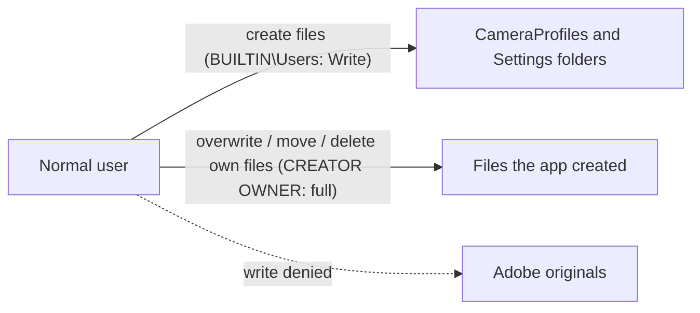

# Camera profiles: folders, formats, rewrite rules

Everything the app reads from and writes to Camera Raw. Facts below were checked on a real Camera Raw install (2936 camera DCPs, 1503 Adobe Standard DCPs, ~540 XMPs).

## Folders

All paths are under `C:\ProgramData\Adobe\CameraRaw` and live in `AppPaths`.

| What | Path | Access |
|---|---|---|
| Camera Raw installed? | `C:\ProgramData\Adobe\CameraRaw` exists | read |
| DCP camera profiles | `CameraProfiles\Camera\<Model>\<Model> Camera <Name>.dcp` (also `Camera_<Name>.dcp`, e.g. Leica D-Lux 7). Folder name = model. | read only |
| Adobe Standard (sensor calibration) | `CameraProfiles\Adobe Standard\<Model> Adobe Standard.dcp`, some also `<Model> Adobe Standard v2.dcp`. 312 of 1503 file names differ from the camera model (phones, drones, `Leica D-Lux 7 Adobe_Standard.dcp`, upper case). | read only |
| Camera Standard (XMP base) | `CameraProfiles\Camera\<Model>\<Model> Camera Standard.dcp` (only some cameras) | read only |
| XMP camera profiles | `Settings\Adobe\Profiles\Camera\<Brand>[\<Model>]\<Model> Camera <Name>.xmp`. Scanned recursively; the model comes from `crs:CameraModelRestriction`, not the folder (some sit flat in the brand folder). | read only |
| **DCP output** | `CameraProfiles\Phan Xuan Quang\` | app writes |
| **XMP output** | `Settings\Phan Xuan Quang\` | app writes |

Output file name: `<Source model> <Name> (for <Target model>).<dcp|xmp>`, e.g. `Canon EOS R5 Portrait (for Sony ILCE-7M4).dcp`. Characters invalid in file names become `-`.

Do **not** write to `%AppData%\Adobe\CameraRaw\Settings`: that is Camera Raw's per-image settings database.

Fujifilm camera profiles exist only as XMP here. 88 of them are stubs that point to a table built into Camera Raw (`crs:RGBTable` hash); copied stubs still render.

### Permissions: no admin needed

The app runs as a normal user and never elevates. It assumes a first install: files written by the old (admin) app are not detected or removed.

### App data

`%LocalAppData%\CameraProfilesUnlocker\`

| File | Content |
|---|---|
| `settings.json` | target camera |
| `installed.json` | manifest: name, source model, target model, file paths |
| `trash\` | removed files kept for Undo, emptied when the app closes |

Both JSON files are written to `<file>.tmp` then renamed over the original, so a crash never leaves half-written JSON. A corrupt or unreadable manifest means starting empty (files stay on disk; untracked files are never deleted). Null or incomplete entries are skipped. Entries whose files are gone are dropped at load.

## Rewrite rules

Both formats follow the same flow:

**Shared rules** (`Unlocker.Core/Rules/CameraProfileRewriter`), on the keys `Name`, `Copyright`, `CameraModelRestriction`:

- `Name`: `Camera X` → `<Source model>: X`, so names stay unique in the Profile Browser.
- `Copyright`: the author credit from `Directory.Build.props` (`Copyright`).
- `CameraModelRestriction`: the target model.
- A missing tag stays missing. The source is never modified; output is always a new file. Never a line-based text replace.

`CameraProfileInstaller` only picks the installer by format.

### DCP (binary)

Format: TIFF with header `IIRC` (little endian, magic `RC` instead of 42), one IFD at offset 8, no sub-IFDs, no pointers inside values, so every entry is self-contained. Big-endian `MMCR` is not supported (no Adobe DCP uses it).

`DcpProfileInstaller` + `DcpFile` (own C#; replaced dcpTool):

1. Read the source into a pooled buffer. `DcpFile.Parse` keeps entries as slices of that buffer (no copies). Bad header or out-of-bounds entry → `InvalidDataException`.
2. **Calibration**: read the target's Adobe Standard DCP and take its sensor calibration (`ColorMatrix1/2`, `CalibrationIlluminant1/2`, `IlluminantData1/2`). The source keeps its look: `ForwardMatrix`, look table, tone curve, exposure offset.
   - All third-illuminant tags (DNG 1.6) are dropped.
   - If the target has only one illuminant, the source's second-illuminant look (`ForwardMatrix2`, `ProfileHueSatMapData2`) is dropped too.
   - Which file: `<Target> Adobe Standard v2.dcp`, else `<Target> Adobe Standard.dcp`, else the file whose `UniqueCameraModel` is the target (folder read once per session on the first miss; `v2` wins there too). v2 = Adobe's newer calibration of the same camera: 11 cameras have one; v1 and v2 differ in `ColorMatrix`, `ForwardMatrix` and HueSatMap, and Adobe's own camera-matching profiles of those cameras pair with both ("Camera X" with v1, "Camera X v2" with v2). By name alone 3 of 427 catalog models missed (2026-11-25): Leica D-Lux 7 is found by model now; OM Digital Solutions OM-3 Astro and RICOH GR IV Monochrome have no Adobe Standard at all (variants of OM-3 / GR IV with their own sensor response), so they keep the source calibration.
   - No Adobe Standard for the target: log a warning and keep the source calibration.
   - Why: a camera-matching DCP has the same `ColorMatrix` as its camera's Adobe Standard, and its `ForwardMatrix` is identical across cameras; the look lives in the look table and tone curve. So target matrices + source look is the pairing Adobe itself would use. The look table still holds some source-sensor tweaks that cannot be separated.
   - On the real files checked, every Adobe Standard and camera DCP has two illuminants and no third, so the single- and third-illuminant branches are covered by unit tests only.
3. String tags as a dictionary: `CameraModelRestriction` (0xC614 UniqueCameraModel), `ProfileCalibrationSignature` (0xC6F4), `Name` (0xC6F8), `Copyright` (0xC6FE).
4. DCP rule on top of the shared rules: `ProfileCalibrationSignature` `com.adobe` → author signature (`AssemblyMetadata("Author")`).
5. `WriteTo`: header, IFD at 8 sorted by tag, out-of-line values word-aligned. Strings NUL-terminated, ASCII when possible else UTF-8 bytes (same as the DNG SDK). Every other entry is copied byte for byte. A failed write deletes the partial file.

Parity: all 2936 Adobe DCPs were rewritten by `DcpFile` and compared against dcpTool output: identical. dcpTool (GPLv2) was only read for reference.

### XMP (text)

Namespace `crs` = `http://ns.adobe.com/camera-raw-settings/1.0/`. Useful attributes on `rdf:Description`: `PresetType="Look"`, `UUID`, `CameraModelRestriction`, `Copyright`, `CameraProfile` (base profile), `RGBTable`. Name in `crs:Name/rdf:Alt/rdf:li` (one `x-default` entry, value `Camera <Name>`).

`XmpProfileInstaller` uses `XDocument` only:

- Shared rules; every `rdf:li` of `crs:Name` gets the new name.
- `UUID`: a new GUID. Reusing the original UUID collides in Camera Raw.
- `CameraProfile` (the base the look sits on, found by name for the target), first match wins:
  1. No `CameraProfile` in the source (RICOH GR IV Monochrome): none is added.
  2. The source's base if it is `Adobe Standard` or the target has `<Target> <Base>.dcp` (e.g. Panasonic `Camera Cinelike D2`).
  3. The source's base if it has no DCP for the source either (built into Camera Raw: Fujifilm `Camera PROVIA/Standard`, Nikon D780 `Camera Standard v2`) and source and target share the brand (first word of the model). Not checked per model: Camera Raw's built-in list is not on disk.
  4. `Camera Standard v2`, then `Camera Standard`, if the target has that DCP (Adobe's own Nikon XMPs use v2 where it exists).
  5. `Adobe Standard` (every supported camera has it).
- Bases in Adobe's XMPs (2026-11-25): Fujifilm 89 `Camera PROVIA/Standard`; Nikon 280 `Camera Standard` + 80 `Camera Standard v2`; Panasonic 34 `Camera Standard` + 4 `Camera Cinelike D2`; Ricoh 4 `Camera Standard` + 3 none; Sigma 45 `Camera Standard`.
- A failed write deletes the partial file.

The catalog reads only the first `rdf:Description` start tag of each XMP (the files embed large tables).

## Tests

- Shared rules: `CameraProfileRewriterTests`.
- DCP: `DcpFileTests.Sample()` builds a tiny DCP in code, including a byte-for-byte round-trip test. Calibration cases (third illuminant, single illuminant, illuminant data) are covered there.
- Installers: `CameraProfileInstallerTests` (file names, partial-file cleanup). Fixture `tests/Unlocker.Tests/Fixtures/sample.xmp` (Fujifilm X-T5 BLEACH BYPASS stub).
- Catalog: `FileCameraCatalogTests` (underscore names, inaccessible folder, retry after a failed scan).
- Always assert the source file hash is unchanged.
- A change to the output must also be checked in Camera Raw's Profile Browser on a real raw file.
