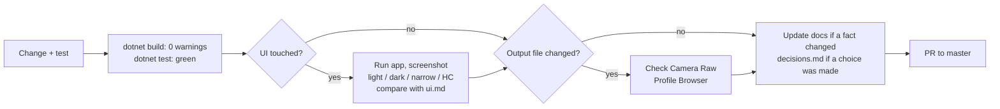
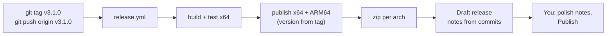

# Development

## Setup

- Windows 10 1809+ (Windows 11 recommended), .NET SDK per [global.json](../global.json).
- Visual Studio 2026 with the **WinUI application development** workload, or the [WinApp CLI](https://github.com/microsoft/WinAppCli) (`winget install Microsoft.winappcli`).
- Camera Raw installed, to run against real camera profiles.

```powershell
cd src
dotnet build Unlocker.slnx                       # also builds the tests; must be 0 warnings
dotnet test ../tests/Unlocker.Tests
winapp run Unlocker.WinUI                         # or F5 in Visual Studio (runs unpackaged)
..\tests\ui-tests.ps1 -Target local               # UI smoke batch (see Testing)
```

The dev machine may be ARM64: default output is then `bin\ARM64\...`. Pass `-p:Platform=x64` or `ARM64` to pick.

## Change workflow



## Conventions

### C#

- File-scoped namespaces, `sealed` by default, implementations `internal`, records for models.
- Nullable on, warnings are errors. No `!` without a comment.
- Async for all I/O, `Async` suffix, last parameter `CancellationToken ct = default` (exceptions in [architecture.md](architecture.md#threading-and-cancellation)). No `.Result`, `.Wait()` or `async void` outside XAML event handlers.
- Standard library first (`XDocument`, `System.Text.Json` source-gen, `HttpClient`, `Directory.EnumerateFiles`). No new package without a reason.
- No `Parallel.*` for file lists of this size.
- Static classes only where the language needs them (extension methods, x:Bind helper functions). Rules are sealed classes resolved by DI.
- One installer per profile format, same flow (see [camera-profiles.md](camera-profiles.md#rewrite-rules)). No format `switch` outside `CameraProfileInstaller`.
- Comments explain **why**, only when the code cannot. A deliberate shortcut gets `// shortcut: <limit>, <when to upgrade>`.

### MVVM (CommunityToolkit.Mvvm)

- `partial` ViewModels, `[ObservableProperty]` partial properties, `[RelayCommand]`.
- ViewModel constructors take interfaces only. No UI types in Presentation.
- Never replace a bound `ObservableCollection`; update it in place (keeps selection, scroll and focus).

### XAML (WinUI)

- Check controls and APIs before writing: `winapp find-ui "<intent>"`, `winapp find-api members <Type> --project-dir src/Unlocker.WinUI`. For .NET or Windows App SDK APIs, use Microsoft Learn.
- Pages and user controls set `x:DefaultBindMode="OneWay"` (the WinUI analyzer fails the build on implicit OneTime). Immutable record data: explicit `Mode=OneTime`. Two-way `TextBox`: `UpdateSourceTrigger=PropertyChanged`.
- `{ThemeResource}` brushes only, built-in text styles, no literal colors, paddings or radii in pages. Shared resources and styles live in `App.xaml` (`PagePadding`, `PageSpacing`, `ItemSpacing`, `CardGridStyle`, `TileGridStyle`, `SecondaryTextStyle`, `IconButtonStyle`, converters).
- Fluent geometry: page cards and dialogs `OverlayCornerRadius` (8), controls inside `ControlCornerRadius` (4), never pills.
- Reuse CommunityToolkit.WinUI (Converters, Triggers, `SettingsCard` / `SettingsExpander`) before writing a control. No `ScrollViewer` around `ListView`/`GridView`.
- A page that binds to a singleton ViewModel's collections sets their `ItemsSource = null` on `Unloaded`, or each visit leaks the page.

Gotchas we hit:

| Symptom | Cause / fix |
|---|---|
| Page content clipped on the right | `ScrollViewer > StackPanel(MaxWidth, Margin)` measures wider than the window. Use `ScrollViewer > Grid(Padding) > Panel(MaxWidth)`. |
| Button handler gets a null item in a `SettingsExpander` template | `DataContext` is null there. Pass the item with `Tag="{x:Bind Mode=OneTime}"`. |
| CS1503 in generated code for `MainWindow.xaml` | `Window` is not a `FrameworkElement`; x:Bind there cannot use resource converters. Set those values in code. |
| WMC9999 internal error | x:Bind indexer on `IReadOnlyList`, or an enum-to-enum cast. Set in code-behind, or map with `IsEqualStateTrigger`. "Could not find any resources" hides the real error: bisect the last XAML edit. |
| Visual states never fire | `VisualStateManager.VisualStateGroups` work only on the page root element. |
| Second `ContentDialog` throws | WinUI allows one open dialog per thread. `DialogService` serializes them. |

## Testing

- One MSTest project; folders mirror the layers (`Core/`, `Infrastructure/`, `Presentation/`), one test class per subject. Hand-written fakes in `Fakes/` (one per file), no mocking framework.
- File-system tests derive from `Support/TempFolderTest` (temp `AppPaths`, never the real Camera Raw folders).
- New logic (a branch, a parser, file writes, a bug fix) gets a test that fails without the change.
- **UI smoke batch** `tests/ui-tests.ps1 -Target local`: startup, selection, a real install of one XMP, remove + Undo, bulk-remove dialog, empty states, search, "Your camera" pane, Settings, and an AutomationId audit. It writes `tests/test-results.json` and PNGs in `tests/ui-test-artifacts/` (git-ignored): look at every PNG.
  - Run locally (the Windows Sandbox has no Camera Raw). Preconditions: a target camera is set and nothing is installed by the app. It cleans up after itself.
  - Run the whole batch in one call: an app launched with `winapp run --detach` from a short-lived shell can die with that shell.
- Manual check for output changes: install a DCP and an XMP for a camera you have raw files of, restart Lightroom/Photoshop, apply them in the Profile Browser, then remove + Undo.

## Release



- Format: unpackaged, self-contained (no .NET install needed), one zip per architecture. Publish-only settings in `Unlocker.WinUI.csproj`: `SelfContained`, `WindowsPackageType=None`, `PublishReadyToRun`. Non-English `.mui` folders are removed after publish.
- Local build of the same folder: `dotnet publish Unlocker.WinUI -c Release -p:Platform=x64 -o out\x64`.
- The in-app update check compares the running version with the latest **published** release tag, so always tag `vX.Y.Z`. Drafts are invisible to it.
- Release notes: `.github/release-notes.ps1` groups commit subjects since the previous `v*` tag (`feat` → Features, `fix` → Fixes, the rest folded under Maintenance) into `.github/release-notes-template.md`, which also holds the fixed install instructions. Commit messages therefore follow conventional commits. Before publishing, rewrite "What's new" for photographers; with Claude Code: *"write release notes for vX.Y.Z"* (it edits the draft with `gh release edit`). Preview locally: `./.github/release-notes.ps1 -Tag HEAD`.
- Not code-signed yet: SmartScreen warns on first run. Signing would be one step before zipping (SignPath Foundation, free for open source, or Azure Artifact Signing).
- CI (`ci.yml`) builds x64 + ARM64 and runs the tests on every push and PR to `master`. Dependabot updates NuGet packages and Actions.

## App icon

The logo is drawn in SVG: `tools/icon/app-icon.svg` (48 px and up) and `tools/icon/app-icon-small.svg` (simplified, 32 px and below). After editing either, run `./tools/generate-icons.ps1` (headless Edge, no other tools): it rewrites `AppIcon.ico`, the PNGs that `Unlocker.WinUI.csproj` and `Package.appxmanifest` reference, `site/assets/img/favicon.ico` and `site/assets/img/logo.svg` (site header and SVG favicon). Check the result in the title bar and taskbar.

## Website

Public page for photographers at <https://phanxuanquang.github.io/Adobe-Camera-Profiles-Unlocker/>: download, SmartScreen help, how it works, brands, FAQ, donations. The maintainer docs here are not its content; reuse facts from the root README.

```
site/
  index.html, 404.html          # one page; 404 uses absolute /Adobe-Camera-Profiles-Unlocker/ paths
  assets/css/site.css           # Fluent (WinUI 3) light tokens mapped onto Bootstrap variables
  assets/js/main.js             # wires the modules below
  assets/js/release.js          # latest release from the GitHub API, download buttons
  assets/js/lightbox.js         # screenshots open full size in a native <dialog>
  assets/js/motion.js           # Anime.js dialog open, skipped under prefers-reduced-motion
  assets/img/                   # app screenshots (copies of .github/assets), donation QR code (also used by README), logo.svg + favicon.ico (from tools/generate-icons.ps1), social.png (1280x640: og:image and the GitHub social preview)
```

- Look: follows the [Windows design guidelines](https://learn.microsoft.com/windows/apps/design), light theme only. Colors are WinUI theme resources (names in `site.css` comments), accent `#0078D4`, 4 px control and 8 px card corners, Segoe UI Variable type ramp (Roboto where Segoe is missing).
- Plain HTML, ES modules, no build and no npm. Bootstrap 5.3, Anime.js 4 and Lucide come from jsDelivr with exact versions and SRI hashes; Roboto from Google Fonts (no SRI possible: the CSS differs per browser). To bump a library, change the version and recompute the hash: `curl -sL <url> | openssl dgst -sha384 -binary | openssl base64 -A`.
- Every download link points at `/releases/latest` in the HTML; `release.js` only upgrades them to the zip for the visitor's CPU. If the API fails or is rate-limited, the page still works.
- New app screenshots: replace the files in `.github/assets`, copy them to `site/assets/img`, update `width`/`height` and `alt` in `index.html`.
- Wording follows [ui.md](ui.md#wording): always **camera profile(s)**. No tracking or analytics.
- Preview: `python -m http.server -d site 8000`, then open <http://localhost:8000/>. Look at it in a browser (not just the code) at 375, 768 and 1280 px, with reduced motion and keyboard only.
- Deploy: `.github/workflows/pages.yml` uploads `site/` on every push to `master` that touches it (or run it by hand). One-time setup: repo **Settings > Pages > Source: GitHub Actions**.

## AI assistants

[CLAUDE.md](../CLAUDE.md) holds the rules for AI coding assistants. Useful skills when working with Claude Code:

| Task | Skill / tool |
|---|---|
| WinUI build, run, crash | `winui:winui-dev-workflow` |
| XAML, picking controls | `winui:winui-design`, `winapp find-ui`, `winapp find-api` |
| Review before a PR | `code-review`, `winui:winui-code-review`, `ponytail:ponytail-review` |
| UI tests, screenshots of the running app | `winui:winui-ui-testing`, `winappcli:winapp-ui-automation`, `winappcli:winui-devtools` |
| Packaging, signing | `winui:winui-packaging`, `winappcli:winapp-signing` |
| Tests | `superpowers:test-driven-development`, `dotnet-test:run-tests` |
| Bugs | `superpowers:systematic-debugging` |
| Unknown .NET / Windows App SDK API | Microsoft Learn MCP |
