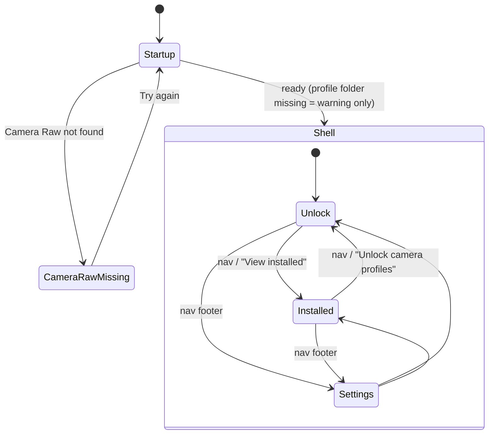

# UI

The spec for every screen. Check a UI change against this file and against the real app (screenshots), not against the code alone.

## Wording

- Always **camera profile(s)**. Never "look" or a bare "profile". Brand family names ("Film Simulations") stay.
- English only. Strings live in ViewModels and XAML.

## Navigation

Shell: `NavigationView` on the left with **Unlock camera profiles**, **Installed** (count `InfoBadge`, count also in its accessible name) and **Settings** in the footer. The pane and its toggle are hidden on the Startup page. Mica backdrop. Follows the Windows theme (no theme setting). Window ~1280×800 DIP, minimum ~760 wide, sized by monitor DPI.

## Startup

- Loading: `ProgressRing` + "Getting ready".
- Camera Raw missing: full page with "Get Camera Raw" (opens `https://www.adobe.com/go/acr_installer_win`) and "Try again". The app never exits on an error.
- DCP or XMP profile folder missing: warning `InfoBar` on the Unlock page; the app stays usable. The log says which folder.
- No update check at startup (Settings checks instead). No admin screen.

## Unlock

- **Header**: title + "Your camera" button. It opens a `SplitView` pane on the right (overlay, light dismiss) with a search box, a brand filter `ComboBox` and models grouped by brand. Picking a model closes the pane.
- **First run** (no target camera): an inline card "Which camera do you shoot with?" with the same picker. The tray is hidden.
- **Left pane**: brand `ListView` (name, family, `selected/total`, "Your brand" tag). Arrow keys move focus only; Enter or click selects. Above it, `AutoSuggestBox` "Search camera profiles" searches all brands; brands with no match are hidden.
- **Right pane**: `<Brand> <Family>` title, "Copied from" `ComboBox` (default = most camera profiles), "Select all" / "Clear choices", then tiles: `CheckBox` + name + an installed icon with tooltip. A tile is "installed" when the same name from the same source model is installed for the target camera; installed tiles are locked and "Select all" skips them. A selected tile that becomes installed leaves the selection.
- **Search mode**: results grouped by brand; empty state with "Clear search".
- **Tray** (always visible once a camera is set): selected chips (removable, max 4 + "+N more"), Clear (with Undo), accent "Install N camera profiles".
- **Install**: tray shows "Installing i of N: <name>", the Install button shows a `ProgressRing` + "Installing…", Cancel is available.
  - Success: `ContentDialog` "Camera profiles installed" (count, target, restart Lightroom/Photoshop, donation ask; primary "Buy me a coffee"), then a short `InfoBar` "Install finished." with **View installed** and **Undo**.
  - Failure or cancel: everything from this run is rolled back; error `InfoBar` with the exception message and **Try again**. Details go to the Windows Event Log.

## Installed

One `SettingsExpander` per target camera, one `SettingsCard` per camera profile ("From <source model>").

- Remove one: instant, with an Undo `InfoBar`.
- Remove a camera group or **Remove all**: `ContentDialog` listing the names, verb button "Remove N", Cancel is the default. Undo afterwards.
- Undo never overwrites a camera profile that was installed again in the meantime.
- "Open folder" and an empty state with "Unlock camera profiles".

## Settings

- **Updates**: app version + status (checking / up to date / version X available / couldn't check). Checked each time the page opens; the status is a live region. "Go to download page" opens the GitHub release page (only `https://github.com` links are accepted); the user downloads by hand.
- **Profile folders**: the DCP and XMP output folders, each with a button that opens it in File Explorer (the folder is created if missing).
- **About**: GitHub, Donate.

## Accessibility (must)

- Visible labels; `AutomationProperties.Name` + tooltip on icon-only buttons.
- Every interactive control has a unique `AutomationId` (the UI test batch audits this).
- Full keyboard path, visible focus, targets ≥ 36 px (tiles 48 px).
- Status through `InfoBar` (live region). Counts that are only visual (badges, brand counts) are repeated in accessible names.
- Light, dark, narrow and High Contrast must all work.
